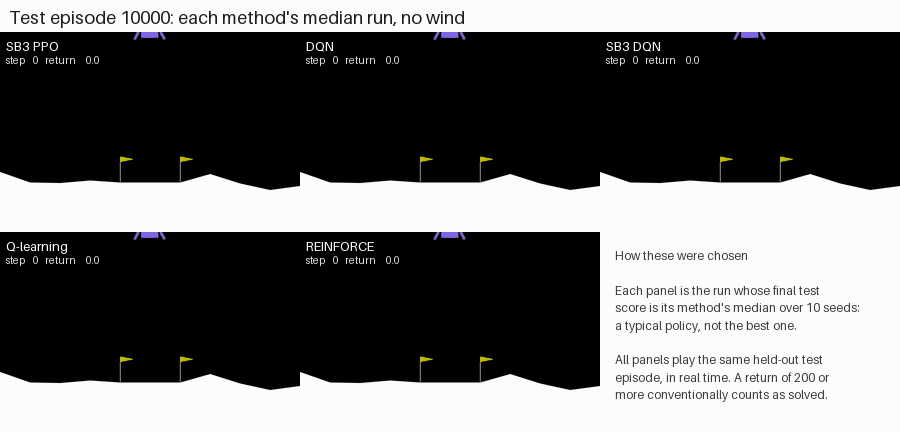
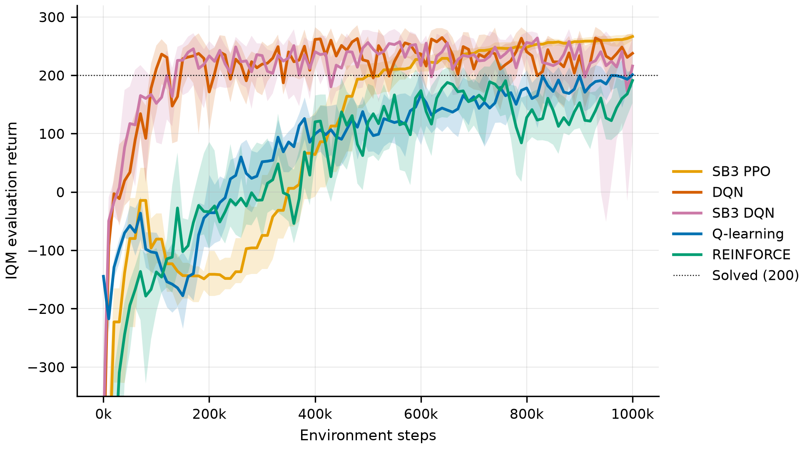
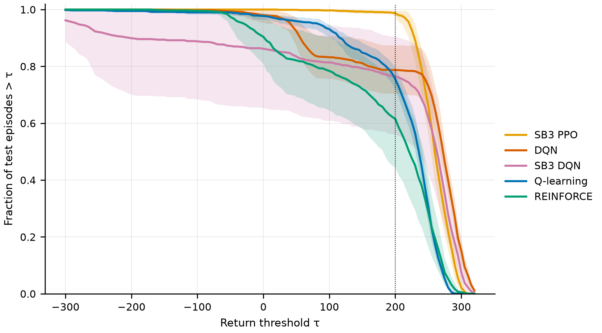

# Lunar Lander RL: a reproducible benchmark

[](https://github.com/bartkw12/Reinforcement-Learning-for-Rocket-Landing-Simulator/actions/workflows/ci.yml)

[](LICENSE)
[](https://github.com/astral-sh/ruff)



*Each method's median policy (over 10 training seeds) on the same held-out test episode, in
real time. Chosen by fixed rules, not hand-picked; see [docs/demos.md](docs/demos.md).*

Three classic reinforcement-learning methods, implemented from scratch, are compared with
Stable-Baselines3 DQN and PPO on Gymnasium's LunarLander-v3:
- tile-coded **Q-learning**;
- **DQN**;
- **REINFORCE**.

All five run under one controlled protocol: an equal budget of 1M environment steps, ten
training seeds per method, 100 held-out test episodes, and bootstrap confidence intervals. The
project began as a single-run coursework study. It was rebuilt so that every number, table and
figure here is regenerated from logged runs by one command, and replicating the original study
changed most of its conclusions.

## Results

<!-- include: results/tables/main_benchmark_headline.md -->
| Method | IQM test return [95% CI] | Mean test return [95% CI] | Success | Training time |
| :--- | ---: | ---: | ---: | ---: |
| SB3 PPO | 260.3 [252.4, 265.8] | 258.8 [251.6, 265.0] | 99% | 8 min |
| DQN | 235.1 [206.6, 260.5] | 234.1 [213.2, 254.5] | 79% | 62 min |
| SB3 DQN | 237.9 [121.3, 262.5] | 183.2 [65.9, 253.6] | 76% | 70 min |
| Q-learning | 213.4 [203.6, 220.8] | 211.5 [203.0, 218.6] | 76% | 4 min |
| REINFORCE | 195.4 [136.8, 219.2] | 178.9 [141.7, 210.3] | 62% | 5 min |
<!-- end include -->

*Final policies' test return over 100 held-out episodes, aggregated over 10 seeds (IQM:
interquartile mean). SB3 rows are reference baselines. Full statistics: [docs/benchmark.md](docs/benchmark.md).*

- **PPO is the strongest and most reliable method.** 99% of its test episodes land, and every
  seed scores between 233 and 274. It is also the slowest to learn.
- **DQN learns fastest and lands most efficiently, but holds its policy less steadily.** Its
  successful landings score higher than PPO's, but 21% of its episodes fall short of 200.
  [Double DQN](docs/ablations.md#a2a-double-dqn-and-the-td-loss) removes this late instability
  (257.3 [253.1, 264.3] on five seeds).
- **The DQN implementation matches Stable-Baselines3's.** With identical hyperparameters, the
  two are statistically indistinguishable (P(DQN > SB3 DQN) = 0.51).
- **Tile-coded Q-learning is a strong, cheap baseline.** Its seeds agree more closely than any
  method's but PPO's, and it uses less than a tenth of DQN's compute.
- **Wind the policies never trained in reverses the ranking.** REINFORCE degrades least and
  Q-learning most ([ablation A3](docs/ablations.md#a3-robustness-to-wind)).

<p align="center">


</p>

*Left: IQM evaluation return during training, with 95% bootstrap bands. Right: fraction of test
episodes above each return threshold. No method dominates at every threshold.*

## Quickstart

```bash
git clone https://github.com/bartkw12/Reinforcement-Learning-for-Rocket-Landing-Simulator.git
cd Reinforcement-Learning-for-Rocket-Landing-Simulator
python -m venv .venv && source .venv/bin/activate        # Windows: .venv\Scripts\activate
pip install -e ".[dev,sb3,media]"
pytest -m "not slow"                                      # unit and integration tests
```

Box2D (LunarLander's physics engine) sometimes needs building from source. If its install
fails, run `pip install swig` first. On Windows, the conda-forge package is an alternative:
`conda install -c conda-forge box2d-py`.

```bash
# train one agent and evaluate it on the held-out test episodes
python scripts/train.py --agent configs/agent/dqn.yaml --seed 0

# watch a trained policy, here under wind
python scripts/record_gif.py episode runs/adhoc/dqn/seed_0 --set env.kwargs.enable_wind=true

# reproduce every experiment, table and figure (about 8 h), or smoke-test the pipeline (minutes)
python scripts/reproduce_all.py --workers 20
python scripts/reproduce_all.py --quick
```

## Environment

LunarLander-v3 (Gymnasium 1.3) has:
- an 8-dimensional state: position, velocity, angle, angular velocity and two leg-contact flags;
- four actions: do nothing, or fire the left, main or right engine.

The reward is shaped:
- approaching the pad slowly and level earns reward;
- each leg touching down earns +10;
- firing engines costs fuel;
- an episode ends with +100 when the lander comes to rest, or −100 when it crashes or leaves
  the screen;
- otherwise it is cut off after 1,000 steps.

A return of 200 counts as solved. Every evaluation also records how each episode ended: landed,
crashed, out of bounds or timed out. That record exposes failure modes, such as hovering until
the time limit, that the mean return hides.

## Methods

| Method | Approach | Key settings |
| :--- | :--- | :--- |
| Q-learning | linear Q-function over 16 tilings of the state (tile coding) | α = 0.3, 6 tiles per dimension, ε 1 → 0.05 over 100k steps |
| DQN | neural Q-network, replay buffer, target network, Huber loss | 2 × 256 units, lr 3e-4, target sync every 250 steps |
| REINFORCE | Monte Carlo policy gradient, one update per episode | normalised returns, entropy bonus 0.01, lr 3e-3 |
| SB3 DQN | Stable-Baselines3 DQN | the project's DQN settings, as an implementation check |
| SB3 PPO | Stable-Baselines3 PPO | RL Baselines3 Zoo's tuned values, 16 parallel environments |

The value-based methods regress onto one-step targets that stop bootstrapping only when the
episode truly terminates. A time-limit cutoff is not treated as termination:

$$y = r + \gamma\,(1 - \text{terminated})\,\max_{a'} Q(s', a')$$

REINFORCE follows $\nabla J \approx \sum_t \nabla \log \pi(a_t \mid s_t)\, \hat G_t$, with returns
$\hat G_t$ standardised within each episode, plus an entropy bonus. Details and equations are in
the [technical report](docs/report.md#3-methods).

## Experimental protocol

- **Equal experience.** Every run trains for exactly 1,000,000 environment steps.
- **Tuning kept apart from testing.** Hyperparameters were tuned at the full budget on separate
  training seeds (0–2) and separate validation episodes (seeds 30000–30099)
  ([results](results/tables/tuning.md)).
- **Ten benchmark seeds** (100–109) per method.
- **Held-out test episodes.** Each final policy plays the same 100 test episodes (seeds
  10000–10099), which neither tuning nor checkpoint selection ever saw.
- **Statistics for small samples.** IQM, mean, median and optimality gap with stratified
  bootstrap intervals, performance profiles, and pairwise probabilities of improvement
  (Agarwal et al., 2021).

## Studies

| Study | Question | Report |
| :--- | :--- | :--- |
| Replication of v1.0 | Do the original coursework results survive bug fixes and five seeds? | [docs/replication.md](docs/replication.md) |
| Reference baselines | Does the project's DQN behave like Stable-Baselines3's? | [docs/baselines.md](docs/baselines.md) |
| Main benchmark | How do the five methods compare at an equal budget? | [docs/benchmark.md](docs/benchmark.md) |
| Ablations A1–A2 | REINFORCE's baseline and entropy bonus; Double DQN, TD loss, discount factor | [docs/ablations.md](docs/ablations.md) |
| Ablation A3 | How robust are the policies to wind they never saw? | [docs/ablations.md](docs/ablations.md#a3-robustness-to-wind) |
| Demonstrations | What do typical policies and failures look like? | [docs/demos.md](docs/demos.md) |
| Technical report | Everything above, written up as a paper | [docs/report.md](docs/report.md) |

## Discussion

- **Protocol is part of the result.** The v1.0 study ranked DQN first and REINFORCE last from
  single unseeded runs with different episode budgets. Fixing three learning bugs, measuring
  budgets in steps and using several seeds reversed several of its conclusions. One v1.0
  Q-learning result even turned out to depend on a bug that made training explore by accident
  ([replication](docs/replication.md)).
- **Instability, not learning speed, separates the value-based methods from PPO.** Both DQNs
  find good policies within about 100k steps but do not hold them. Their best checkpoints
  outscore their final policies. A mean-squared-error loss turns this into divergence; Double
  DQN removes it.
- **Hovering is the common failure.** Whenever avoiding the crash penalty is easier than
  earning the landing bonus, policies learn to hover until the time limit. This happens with a
  short discount horizon, too little exploration, or simply some of DQN's episodes.
- **Calm-air score is not robustness.** The best calm-air method (PPO) and the cheapest
  (Q-learning) both lose more under wind than REINFORCE, the weakest calm-air method.

## Limitations

- One environment (LunarLander-v3) and one budget (1M steps).
- PPO's hyperparameters come from a larger external search than the project's small tuning
  grids.
- Ten seeds settle only the larger differences; several pairwise comparisons remain
  inconclusive.
- Stochastic policies are evaluated greedily, which can understate them.
- Wind was tested only at evaluation time, never in training.

## Reproducibility

- **Byte-for-byte on the same platform.** Runs are seeded throughout and use deterministic CPU
  kernels. Re-running a configuration on the same platform reproduces its training log and
  evaluations exactly; `scripts/train.py --from-run <run> --check` verifies any run.
- **Recorded provenance.** Each run records its resolved config, git commit, package versions
  and platform.
- **Generated outputs.** Every table and figure is regenerated from the runs by
  `scripts/report.py`. The tables in this README and in `docs/` are generated
  (`scripts/sync_docs.py`), and CI fails if they drift.
- **Weekly smoke test.** A scheduled workflow runs the whole pipeline in quick mode.

Hardware, runtimes, the determinism guarantees and their limits, and how to use the released
runs instead of re-running: [docs/reproducibility.md](docs/reproducibility.md).

## Project structure

```text
configs/                 YAML: environments, agents, experiments, robustness and media specs
src/lunarlander_rl/
  agents/                Q-learning, DQN, REINFORCE, random, Stable-Baselines3 adapters
  components/            tile coding, replay buffer, networks, returns, exploration schedules
  training/              the training loop and the shared recorder (logging, evaluation, checkpoints)
  evaluation/            seeded evaluation, outcome classification, metrics
  analysis/              aggregation, statistics, tables and figures
  config.py              typed, validated configs        sweep.py       parallel experiment grids
  robustness.py          re-evaluation under new conditions
  media.py               animations                     reports.py     every experiment's report
scripts/                 train, sweep, evaluate, robustness, report, reproduce_all, record_gif,
                         sync_docs, package_release
results/                 generated summaries (CSV), tables (Markdown), figures, animations
docs/                    study reports, technical report, reproducibility guide, v1.0 legacy results
tests/                   unit, integration and slow learning tests
```

## From v1.0 to v2.0

The original coursework version is preserved under the git tag `v1.0-course-project`, with its
published results in [docs/legacy](docs/legacy/v1_results). v2.0 fixed its learning bugs and
rebuilt it as a tested package. It added the replication, the benchmark, Stable-Baselines3
baselines, ablations, interval statistics, the reproduction tooling and these documents. See
the [changelog](CHANGELOG.md).

## Future work

- Train under wind, rather than only evaluating under it, to test whether the robustness
  differences come from what each method's training explores.
- Measure how much greedy evaluation understates REINFORCE and PPO, against sampled actions.
- Study tile-coding resolution and hash-table size for Q-learning.
- Add more seeds to settle the inconclusive pairwise comparisons, and test the methods on
  LunarLanderContinuous.
- Publish the trained policies on the Hugging Face Hub.

## References

- Agarwal, R., et al. (2021). Deep reinforcement learning at the edge of the statistical precipice. *NeurIPS*.
- Mnih, V., et al. (2015). Human-level control through deep reinforcement learning. *Nature*, 518, 529–533.
- Raffin, A., et al. (2021). Stable-Baselines3: Reliable reinforcement learning implementations. *JMLR*, 22(268), 1–8.
- Schulman, J., et al. (2017). Proximal policy optimization algorithms. *arXiv:1707.06347*.
- Sutton, R. S., & Barto, A. G. (2018). *Reinforcement Learning: An Introduction* (2nd ed.). MIT Press.
- Towers, M., et al. (2024). Gymnasium: A standard interface for reinforcement learning environments. *arXiv:2407.17032*.
- van Hasselt, H., Guez, A., & Silver, D. (2016). Deep reinforcement learning with double Q-learning. *AAAI*.
- Williams, R. J. (1992). Simple statistical gradient-following algorithms for connectionist reinforcement learning. *Machine Learning*, 8, 229–256.

The full reference list is in the [technical report](docs/report.md#references).

## Citation

If you use this code or its results, please cite it using the metadata in
[CITATION.cff](CITATION.cff) (GitHub's "Cite this repository" button). Released under the
[MIT licence](LICENSE).
