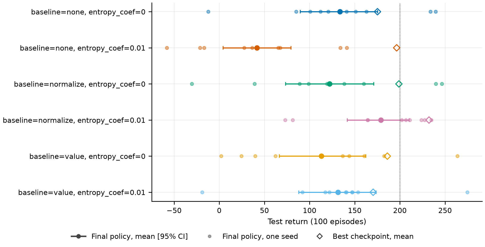
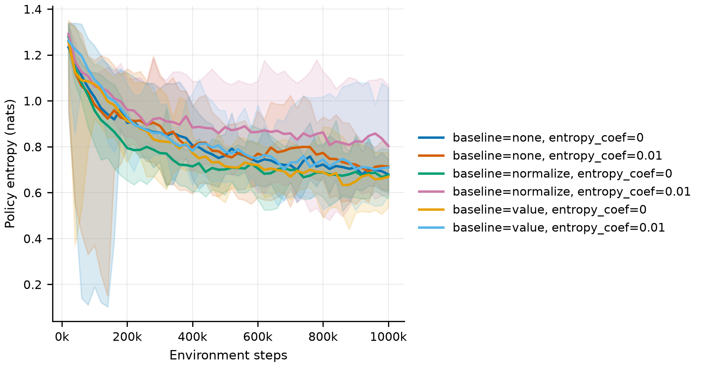
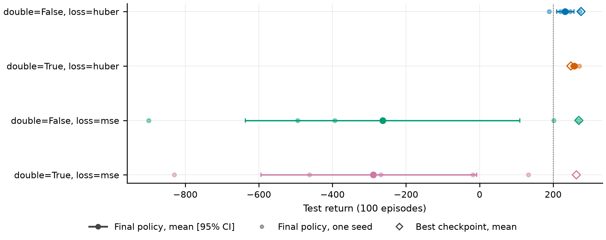
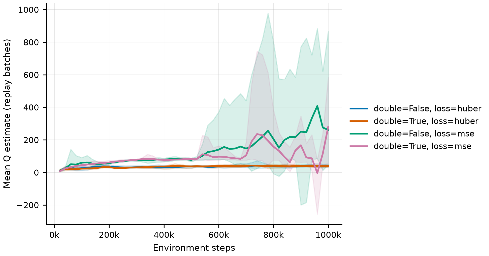
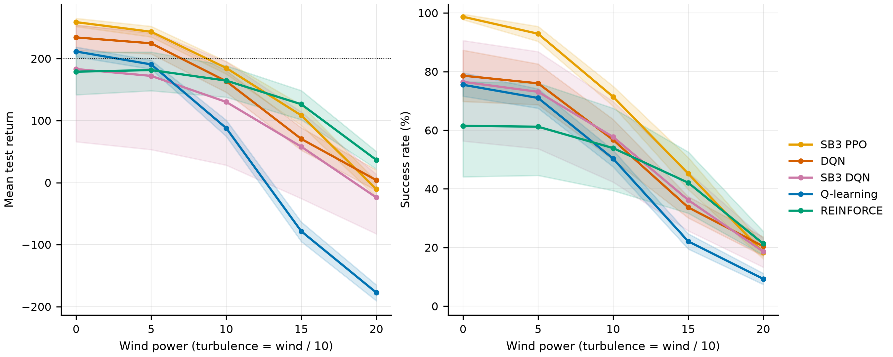

# Ablations

The [main benchmark](benchmark.md) ranks the methods. These ablations ask why they behave as
they do, by changing one design choice at a time and holding everything else fixed:

| | Question | Design | Runs |
| :--- | :--- | :--- | ---: |
| **A1** | How much of REINFORCE's performance comes from its learning signal? | baseline {none, normalised returns, learned value} × entropy bonus {0, 0.01}; 10 seeds, 1M steps | 60 |
| **A2a** | Does Double DQN or the TD loss explain DQN's late instability? | target {DQN, Double DQN} × loss {Huber, MSE}; 5 seeds, 1M steps | 20 |
| **A2b** | Did v1.0's DQN config 3 fail because of its discount factor or its loss? | γ {0.99, 0.9} × loss {Huber, MSE} on v1.0 config 1; 5 seeds, 1,000 episodes | 20 |
| **A3** | How robust are the benchmark's final policies to wind they never saw? | re-evaluation of all 50 benchmark policies at five wind strengths | 250 evaluations |

Every ablation uses the evaluation protocol of the main benchmark. Each variant's final policy
is tested on the same 100 held-out episodes (seeds 10000–10099), and intervals are 95%
percentile-bootstrap intervals over seeds. In A1 and A2a, the cell matching the benchmark
configuration reruns the benchmark's own seeds. A2b's reference cell reruns the replication
study's seeds. All of these reproduce the original runs byte for byte, which is a direct check
of the pipeline's determinism.

## Summary

- **A1: REINFORCE's best result needs both normalised returns and the entropy bonus.**
  Together they score 178.9 [141.7, 210.3]. Every other combination stays between 41.8 and
  133.5 and hovers until the time limit in about half or more of the test episodes. The entropy
  bonus only works with normalised returns: at the other baselines' larger gradient scale, a
  coefficient of 0.01 barely moves the policy's entropy. A learned value baseline does not close
  the gap to PPO (258.8).
- **A2a: Double DQN removes DQN's late instability.** It scores 257.3 [253.1, 264.3] with every
  seed between 252.3 and 271.2, against 232.7 [209.8, 256.8] for standard DQN on the same seeds.
  MSE loss is catastrophic either way (−263.3 and −289.1): the Q estimates diverge after about
  500k steps, and Double DQN does not prevent it.
- **A2b: v1.0's DQN config 3 failed because of its discount factor, not its loss.** With
  γ = 0.9, both losses fail (−114.1 and −128.6, about 70% of test episodes timing out). With
  γ = 0.99, MSE matches Huber (144.8 against 142.2) within v1.0's 1,000-episode budget, which
  ends before MSE's late divergence.
- **A3: wind reverses the benchmark's ranking.** At Gymnasium's default windy setting,
  REINFORCE (126.4) beats PPO (108.3), DQN (70.5) and Q-learning (−78.4). REINFORCE loses 52.5
  return points to that wind, PPO and the DQNs lose 125–164, and tile-coded Q-learning loses
  290: its value function is fitted to the states of calm flight.

## A1: REINFORCE's learning signal

Configuration: [configs/experiments/ablation_reinforce.yaml](../configs/experiments/ablation_reinforce.yaml).
The learning rate stays at its tuned value (3e-3), which tuning chose for normalised returns,
so the other baselines run at a learning rate not tuned for them.



| Agent | Seeds | Env steps | Final return [95% CI] | IQM over seeds | Seed range | Success [95% CI] | Reached 200 | Best checkpoint return | Training time |
| :--- | ---: | ---: | ---: | ---: | ---: | ---: | ---: | ---: | ---: |
| REINFORCE (baseline=none, entropy_coef=0) | 10 | 1,000k | 133.5 [89.8, 175.5] | 131.5 | -12.1 to 239.7 | 32% [14%, 53%] | 5/10 runs | 175.2 | 6 min |
| REINFORCE (baseline=none, entropy_coef=0.01) | 10 | 1,000k | 41.8 [4.2, 79.4] | 37.0 | -58.0 to 141.2 | 9% [3%, 16%] | 8/10 runs, median 810k | 196.4 | 6 min |
| REINFORCE (baseline=normalize, entropy_coef=0) | 10 | 1,000k | 122.3 [73.5, 171.0] | 121.3 | -30.4 to 246.5 | 29% [11%, 52%] | 9/10 runs, median 655k | 198.9 | 5 min |
| REINFORCE (baseline=normalize, entropy_coef=0.01) | 10 | 1,000k | 178.9 [141.7, 210.3] | 195.4 | 73.0 to 234.8 | 62% [44%, 76%] | 10/10 runs, median 385k | 232.2 | 5 min |
| REINFORCE (baseline=value, entropy_coef=0) | 10 | 1,000k | 113.0 [66.6, 162.2] | 109.5 | 2.1 to 263.6 | 23% [6%, 45%] | 5/10 runs | 186.1 | 6 min |
| REINFORCE (baseline=value, entropy_coef=0.01) | 10 | 1,000k | 131.6 [88.1, 173.7] | 135.7 | -18.9 to 274.6 | 24% [10%, 44%] | 6/10 runs, median 490k | 170.4 | 6 min |

| Agent | Landed | Crashed | Out of bounds | Timed out |
| :--- | ---: | ---: | ---: | ---: |
| REINFORCE (baseline=none, entropy_coef=0) | 46% | 7% | 0% | 47% |
| REINFORCE (baseline=none, entropy_coef=0.01) | 24% | 7% | 3% | 65% |
| REINFORCE (baseline=normalize, entropy_coef=0) | 39% | 7% | 0% | 54% |
| REINFORCE (baseline=normalize, entropy_coef=0.01) | 72% | 13% | 0% | 15% |
| REINFORCE (baseline=value, entropy_coef=0) | 29% | 6% | 0% | 65% |
| REINFORCE (baseline=value, entropy_coef=0.01) | 28% | 2% | 0% | 69% |

**Hovering is REINFORCE's dominant failure.** Five of the six variants time out in 47–69% of
test episodes: their policies learn to avoid the crash penalty by staying in the air. Only the
benchmark combination lands most of the time (72%, with 15% timeouts).

**The entropy bonus works only at the right scale.** The bonus adds 0.01 times the policy's
entropy to the objective. Normalised returns have unit scale, so the bonus is a real force
there, and it keeps the policy's entropy noticeably higher throughout training (figure below).
That extra exploration is what gets the policy past hovering. With raw returns or value-baseline
advantages, whose magnitudes are tens to hundreds, the same coefficient barely changes the
entropy. Adding the bonus to raw returns nonetheless lowered the score sharply (133.5 → 41.8,
non-overlapping intervals). Since entropy barely changed, that drop is not explained by
exploration, and this study has no explanation for it.



**A learned value baseline does not help here.** In theory it is the best of the three: it
reduces variance without biasing the gradient. In this setting it is no better than raw returns
(113.0 and 131.6). Two qualifications apply: the learning rate was tuned for normalised returns,
and the value network's own learning rate was not tuned. Either way, a critic used only as a
baseline does not explain PPO's lead (258.8). PPO also bootstraps from its critic through GAE,
clips its updates and learns from batches of parallel episodes.
## A2a: Double DQN and the TD loss

Configuration: [configs/experiments/ablation_dqn.yaml](../configs/experiments/ablation_dqn.yaml).
Seeds 100–104 at 1M steps, otherwise exactly the benchmark's DQN.



| Agent | Seeds | Env steps | Final return [95% CI] | IQM over seeds | Seed range | Success [95% CI] | Reached 200 | Best checkpoint return | Training time |
| :--- | ---: | ---: | ---: | ---: | ---: | ---: | ---: | ---: | ---: |
| DQN (double=False, loss=huber) | 5 | 1,000k | 232.7 [209.8, 256.8] | 233.9 | 189.0 to 272.7 | 78% [68%, 88%] | 5/5 runs, median 50k | 275.8 | 70 min |
| DQN (double=True, loss=huber) | 5 | 1,000k | 257.3 [253.1, 264.3] | 254.3 | 252.3 to 271.2 | 88% [85%, 92%] | 5/5 runs, median 90k | 248.2 | 74 min |
| DQN (double=False, loss=mse) | 5 | 1,000k | -263.3 [-636.4, 109.7] | -228.8 | -899.6 to 269.2 | 33% [0%, 70%] | 5/5 runs, median 110k | 269.8 | 68 min |
| DQN (double=True, loss=mse) | 5 | 1,000k | -289.1 [-594.0, -7.7] | -249.6 | -829.8 to 133.0 | 14% [0%, 37%] | 5/5 runs, median 80k | 263.1 | 73 min |

**Double DQN stabilises the final policy.** With Huber loss, every Double DQN seed's final
policy scores between 252.3 and 271.2, and its interval sits above standard DQN's for almost all
of its width. That is a gain of 24.6 points in the mean, from five seeds. The best checkpoints
tell the same story from the other side. Standard DQN's final policies lose on average 43.1
points against its best checkpoints, the late degradation seen throughout this project. Double
DQN's final policies score *above* its periodically selected checkpoints, which happened to be
chosen on lucky 10-episode evaluations. Its policy no longer degrades late.

**Its average Q estimates are unchanged.** Late in training (beyond 800k steps), the mean Q
value on replay batches is 39.2 for standard DQN and 39.3 for Double DQN. Double DQN is designed
to remove the upward bias of taking a maximum over noisy action values. Here that does not show
up as a lower average estimate. Its benefit comes through which action values feed the target,
not through their overall level. (Replay-batch averages are not true values, so this measures
the estimates' level, not their bias.)



**MSE loss makes the value estimates diverge.** With MSE, mean Q estimates are already about
twice Huber's by 300k–500k steps (79 against 33). After about 500k steps they climb into the
hundreds (256 on average beyond 800k steps, one seed above 600). Every MSE run's best checkpoint
was a good policy (226–282), but three of five final policies under each target are far worse
than random. They mostly crash or fly out of bounds. MSE's gradient grows with the TD error, so
the large errors around crashes (−100) and landings (+100) produce large, compounding updates.
Huber loss caps each sample's gradient. Double DQN slows the divergence (late mean Q 116.5 against
255.9) but does not stop it.

## A2b: what failed in v1.0's DQN config 3

Configuration: [configs/experiments/ablation_dqn_v1.yaml](../configs/experiments/ablation_dqn_v1.yaml).
v1.0's config 1 (64-unit network, 10k buffer, target sync every 10 episodes, 1,000 episodes),
crossing its discount factor with its loss. The γ = 0.99/Huber cell is v1.0 config 1 itself.

| Agent | Seeds | Env steps | Final return [95% CI] | IQM over seeds | Seed range | Success [95% CI] | Reached 200 | Best checkpoint return | Training time |
| :--- | ---: | ---: | ---: | ---: | ---: | ---: | ---: | ---: | ---: |
| dqn_v1 (gamma=0.99, loss=huber) | 5 | 424k | 142.2 [91.5, 180.2] | 154.7 | 49.1 to 197.6 | 45% [28%, 57%] | 2/5 runs | 180.5 | 13 min |
| dqn_v1 (gamma=0.99, loss=mse) | 5 | 405k | 144.8 [104.5, 191.4] | 132.1 | 92.5 to 235.5 | 56% [46%, 71%] | 1/5 runs | 150.1 | 11 min |
| dqn_v1 (gamma=0.9, loss=huber) | 5 | 729k | -114.1 [-187.7, -64.5] | -89.6 | -254.4 to -47.1 | 2% [0%, 5%] | 0/5 runs | -74.3 | 21 min |
| dqn_v1 (gamma=0.9, loss=mse) | 5 | 658k | -128.6 [-163.1, -95.6] | -127.1 | -189.8 to -71.9 | 0% [0%, 0%] | 0/5 runs | -82.0 | 15 min |

| Agent | Landed | Crashed | Out of bounds | Timed out |
| :--- | ---: | ---: | ---: | ---: |
| dqn_v1 (gamma=0.99, loss=huber) | 49% | 38% | 0% | 13% |
| dqn_v1 (gamma=0.99, loss=mse) | 63% | 21% | 4% | 13% |
| dqn_v1 (gamma=0.9, loss=huber) | 2% | 10% | 12% | 76% |
| dqn_v1 (gamma=0.9, loss=mse) | 0% | 4% | 29% | 67% |

**The discount factor is the cause.** At γ = 0.9 both losses fail, and in the same way: the
policy hovers until the time limit (67–76% of test episodes) or drifts off the screen. With an
effective horizon of about 1/(1 − γ) = 10 steps, the +100 for landing is too distant to shape
the descent, while avoiding the −100 crash is easy to learn. At γ = 0.99 the loss makes no
difference within v1.0's budget (144.8 with MSE against 142.2 with Huber). This resolves the
question the [replication study](replication.md) left open.

**The two DQN ablations agree.** v1.0's 1,000 episodes amount to about 400k environment steps,
before the point (about 500k steps in A2a) where MSE's value estimates start to diverge. MSE is
harmless in a short run and destructive in a long one.

## A3: robustness to wind

Configuration: [configs/robustness/wind.yaml](../configs/robustness/wind.yaml). The benchmark's
50 final policies, trained without wind, are re-evaluated without retraining on the same 100
test episodes. Wind power and turbulence rise together; wind 15 with turbulence 1.5 is
Gymnasium's default windy setting. The calm condition reproduces the benchmark's final
evaluations exactly.



Mean test return [95% CI over 10 seeds]:

| Agent | calm | wind_5 | wind_10 | wind_15 | wind_20 |
| :--- | ---: | ---: | ---: | ---: | ---: |
| SB3 PPO | 258.8 [251.6, 265.0] | 243.3 [234.9, 252.1] | 184.8 [175.1, 195.6] | 108.3 [92.2, 125.4] | -10.6 [-23.3, 2.3] |
| DQN | 234.1 [213.2, 254.5] | 224.7 [207.5, 241.0] | 163.5 [145.6, 180.7] | 70.5 [52.3, 88.4] | 4.0 [-12.7, 20.5] |
| SB3 DQN | 183.2 [65.9, 253.6] | 172.1 [53.2, 243.5] | 130.1 [28.2, 195.1] | 57.9 [-25.7, 113.9] | -24.0 [-82.6, 13.5] |
| Q-learning | 211.5 [203.0, 218.6] | 190.6 [183.1, 197.5] | 87.9 [74.6, 100.8] | -78.4 [-95.0, -63.4] | -177.4 [-190.6, -165.0] |
| REINFORCE | 178.9 [141.7, 210.3] | 181.5 [148.2, 210.6] | 164.5 [137.8, 188.6] | 126.4 [101.4, 148.5] | 36.6 [22.0, 50.2] |

Success rate (and the most common failure where it exceeds 5%):

| Agent | calm | wind_5 | wind_10 | wind_15 | wind_20 |
| :--- | ---: | ---: | ---: | ---: | ---: |
| SB3 PPO | 99% | 93% | 71% (25% crashed) | 45% (49% crashed) | 18% (76% crashed) |
| DQN | 79% (15% crashed) | 76% (18% crashed) | 57% (38% crashed) | 34% (62% crashed) | 20% (73% crashed) |
| SB3 DQN | 76% (11% out of bounds) | 73% (12% out of bounds) | 58% (26% crashed) | 36% (46% crashed) | 19% (64% crashed) |
| Q-learning | 76% (11% timeout) | 71% (12% timeout) | 50% (30% crashed) | 22% (66% crashed) | 9% (75% crashed) |
| REINFORCE | 62% (15% timeout) | 61% (13% crashed) | 54% (17% crashed) | 42% (31% crashed) | 21% (56% crashed) |

**Light wind costs little; strong wind costs every method most of its successes.** At wind 5,
every method stays within about 21 return points of its calm score. From wind 10 upwards,
crashing is every method's main way of failing, and by wind 20 it is the most common outcome.

**The ranking reverses.** From calm to Gymnasium's default wind (15):
- REINFORCE loses 52.5 return points;
- SB3 DQN loses 125.3, PPO 150.5 and DQN 163.6;
- Q-learning loses 289.9.

The weakest calm method is the strongest at wind 15 and 20, and at wind 20 it is the only one
whose interval lies entirely above zero. A plausible explanation is the stochastic training
policy, kept broad by the entropy bonus: it visits a wider range of states, leaving the learned
policy better prepared for states that wind produces. This study does not test that directly;
training with wind (ablation A5 in the roadmap) would.

**Tile-coded Q-learning is the most brittle.** Its value function was fitted, tile by tile, to
the states calm flight visits. Its tile bounds were chosen for those states too. Wind pushes the
lander into velocities and angles that fall in edge tiles or tiles training never updated, where
the value estimates carry little information. A neural network's smoother interpolation
degrades more gracefully.

**Calm-weather performance is not a robustness ranking.** PPO is the best method in calm air
and still the most successful at wind 15 (45% against REINFORCE's 42%), but its return falls
faster than REINFORCE's. A method chosen on calm-air performance alone would not have been the
safest choice in wind.

## Reproducing

```bash
python scripts/sweep.py configs/experiments/ablation_reinforce.yaml   # A1: 60 runs, about 20 min with 20 workers
python scripts/sweep.py configs/experiments/ablation_dqn.yaml         # A2a: 20 runs, about 75 min with 20 workers
python scripts/sweep.py configs/experiments/ablation_dqn_v1.yaml      # A2b: 20 runs, about 15 min per run
python scripts/robustness.py configs/robustness/wind.yaml             # A3: needs runs/main_benchmark; about 6 min with 4 workers

python scripts/aggregate.py runs/<experiment>
python scripts/make_tables.py benchmark runs/<experiment> --order <variants>
python scripts/make_figures.py ablation runs/ablation_dqn --metric q_mean "Mean Q estimate (replay batches)"
python scripts/make_figures.py ablation runs/ablation_reinforce --metric entropy "Policy entropy (nats)"
python scripts/make_tables.py robustness configs/robustness/wind.yaml
python scripts/make_figures.py robustness configs/robustness/wind.yaml
```
