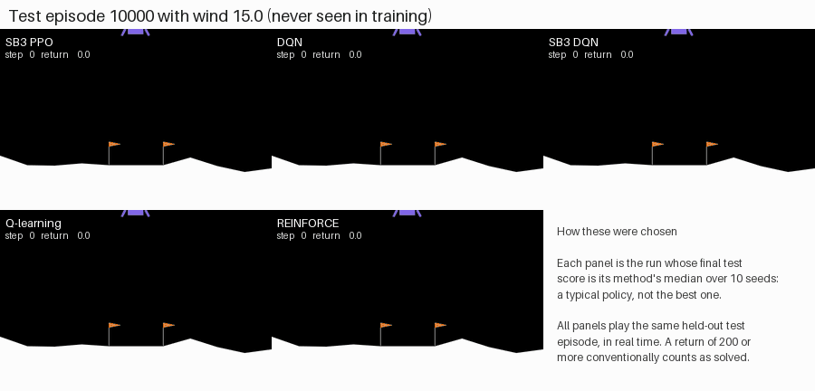
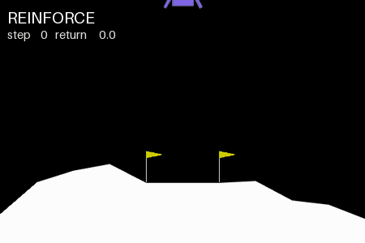
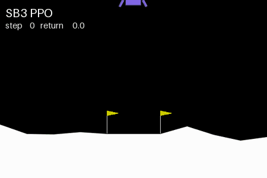
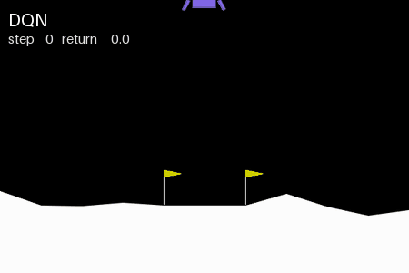
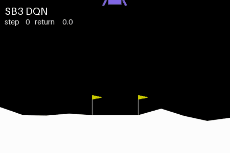
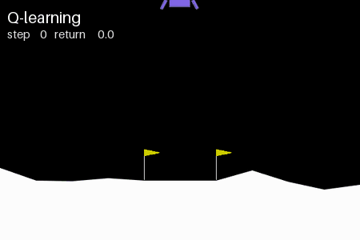
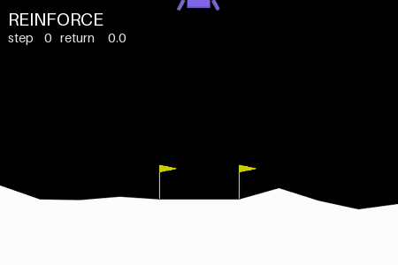

# Demonstrations

Animations of the main benchmark's trained policies. They show what the numbers in the
[benchmark](benchmark.md) look like in flight. They are illustrations, not evidence: each shows
one episode, and the statistics come from 1,000 test episodes per method.

## How the episodes were chosen

The choices follow fixed rules, set in [configs/media/showcase.yaml](../configs/media/showcase.yaml)
before any animation was viewed:

- **A typical policy per method.** For each method, the run whose final test return is closest
  to the method's median over its ten runs. Ties go to the lower seed.
- **The same episode for everyone.** The grids show the first held-out test episode
  (seed 10000), whatever happens in it.
- **A failure.** The failure animation shows the first test episode in which REINFORCE's median
  run did not land.
- **Faithful replays.** Each calm recording replays the evaluation protocol exactly, and is
  checked to have the return that run reported for that episode in its `final_eval.json`.

Every animation plays in real time (25 frames per second, every second simulation step). The
overlay shows the step and the return so far. The badge at the end gives the outcome:
- **landed**: the lander came to rest;
- **crashed**: its body touched the ground;
- **out of bounds**: it left the screen;
- **time limit**: 1,000 steps passed.

## All five methods, same episode


Four of the five median policies land on the pad, each with a return between 252.8 and 270.3.
DQN's median policy reaches the pad but never settles. It keeps firing its side engines, so the
episode only ends at the time limit, with a return of 135.4. It is an example of DQN's
time-limit failures, 6% of its test episodes. Crashes, at 15%, are its more common failure.
Together they are why DQN succeeds less often than PPO, even though its successful landings
score highest (see the performance profiles in the [benchmark](benchmark.md#statistical-comparison)).

## The same episode in wind



The same policies and the same episode, with Gymnasium's default wind and turbulence (wind power
15), which none of them saw in training:
- PPO and SB3 DQN crash;
- DQN and Q-learning land;
- REINFORCE comes to rest beside the pad, with a return of 194.3, short of the 200 that counts
  as a success.

A single windy episode is a sample, not a ranking. [Ablation A3](ablations.md#a3-robustness-to-wind)
measures robustness over all 100 test episodes and ten seeds per method. It finds REINFORCE
degrades least and Q-learning most.

## A failure



REINFORCE's median policy on test episode 10005, the first it fails. The lander drifts right
and leaves the screen (return −167.1). Out-of-bounds failures are rare for REINFORCE (under 1%
of its test episodes). It more often hovers until the time limit or crashes
([outcome breakdown](benchmark.md#statistical-comparison)).

## Each method on its own

<table>
<tr>
<td align="center"><br>SB3 PPO</td>
<td align="center"><br>DQN</td>
<td align="center"><br>SB3 DQN</td>
</tr>
<tr>
<td align="center"><br>Q-learning</td>
<td align="center"><br>REINFORCE</td>
<td></td>
</tr>
</table>

## What each animation shows

<!-- include: results/gifs/showcase.md -->
| Animation | Method | Run | Episode seed | Outcome | Return | Chosen as |
| :--- | :--- | :--- | ---: | :--- | ---: | :--- |
| landing_grid, sb3_ppo | SB3 PPO | sb3_ppo/seed_107 | 10000 | landed | 252.8 | median run, first test episode |
| landing_grid, dqn | DQN | dqn/seed_100 | 10000 | time limit | 135.4 | median run, first test episode |
| landing_grid, sb3_dqn | SB3 DQN | sb3_dqn/seed_100 | 10000 | landed | 258.2 | median run, first test episode |
| landing_grid, q_learning | Q-learning | q_learning/seed_109 | 10000 | landed | 255.0 | median run, first test episode |
| landing_grid, reinforce | REINFORCE | reinforce/seed_103 | 10000 | landed | 270.3 | median run, first test episode |
| reinforce_failure | REINFORCE | reinforce/seed_103 | 10005 | out of bounds | -167.1 | median run, first test episode it failed |
| wind_grid, sb3_ppo | SB3 PPO | sb3_ppo/seed_107 | 10000 | crashed | 10.3 | median run, first test episode, wind |
| wind_grid, dqn | DQN | dqn/seed_100 | 10000 | landed | 279.4 | median run, first test episode, wind |
| wind_grid, sb3_dqn | SB3 DQN | sb3_dqn/seed_100 | 10000 | crashed | 4.3 | median run, first test episode, wind |
| wind_grid, q_learning | Q-learning | q_learning/seed_109 | 10000 | landed | 264.2 | median run, first test episode, wind |
| wind_grid, reinforce | REINFORCE | reinforce/seed_103 | 10000 | landed | 194.3 | median run, first test episode, wind |
<!-- end include -->

## Reproducing

```bash
python scripts/record_gif.py showcase      # every animation above -> results/gifs/ (about 1 min)

# any episode of any run, optionally under changed conditions
python scripts/record_gif.py episode runs/main_benchmark/dqn/seed_100 --seed 10003
python scripts/record_gif.py episode runs/main_benchmark/dqn/seed_100 \
    --set env.kwargs.enable_wind=true --out wind_demo.gif
```

MP4 versions of the grids and the failure are written alongside the GIFs when `imageio-ffmpeg`
is installed (`pip install -e ".[media]"`). Animations regenerate byte-identically from the
same runs.
