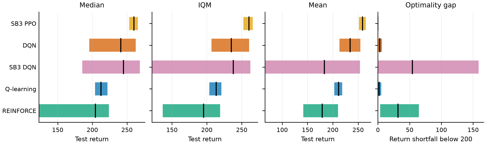
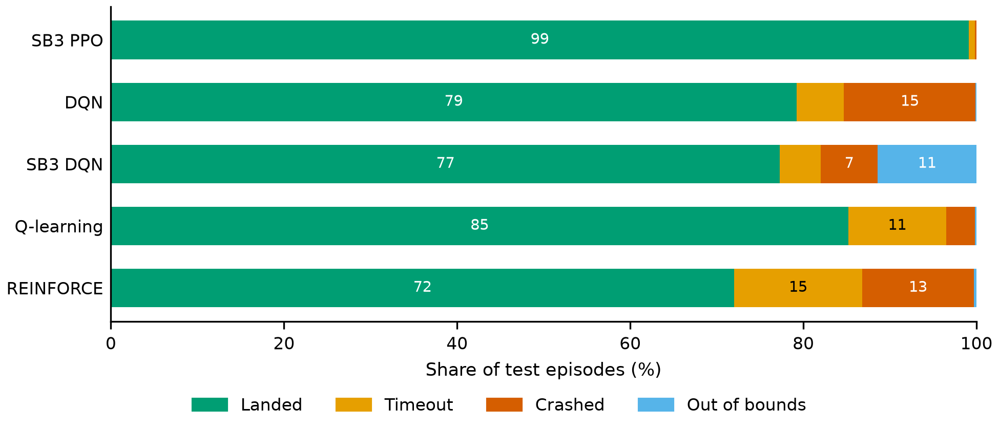

# Landing on the Moon, Reproducibly: Q-learning, DQN and REINFORCE against Modern Baselines on LunarLander

**Bart Kowal** · Technical report, v2.0.0 · October 2026

## Abstract

We revisit a coursework comparison of three reinforcement-learning methods on Gymnasium's
LunarLander-v3: tile-coded Q-learning, DQN and REINFORCE. The original study reported one
unseeded run per configuration and concluded that DQN was best and REINFORCE worst.

We first fix learning bugs in the original implementations and replicate all nine original
configurations with five seeds. Three of the nine results are not reproduced, and the original
ranking does not hold.

We then compare the corrected methods with Stable-Baselines3 DQN and PPO under one protocol:
- an equal budget of one million environment steps;
- ten training seeds per method, unseen during hyperparameter tuning;
- 100 held-out test episodes;
- bootstrap confidence intervals, interquartile means, performance profiles and
  probabilities of improvement.

PPO is the strongest and most reliable method (mean test return 258.8, 99% successful landings).
The project's DQN is second (234.1) and matches Stable-Baselines3's DQN. Tile-coded Q-learning
reaches 211.5 with less than a tenth of DQN's compute. REINFORCE trails (178.9).

Ablations show that:
- Double DQN removes DQN's late-training instability;
- a mean-squared-error TD loss makes value estimates diverge after about 500k steps;
- REINFORCE needs both normalised returns and an entropy bonus.

Under wind the policies never saw, the ranking reverses: REINFORCE degrades least and
Q-learning most. Every number in this report is regenerated from logged runs by a single
command.

## 1 Introduction

Small reinforcement-learning comparisons are easy to get wrong. Results vary strongly across
random seeds, implementation details change outcomes, and budgets measured in episodes hide
large differences in experience (Henderson et al., 2018; Agarwal et al., 2021). The first
version of this project (v1.0) is a case in point. It trained three agents on LunarLander with
one unseeded run per configuration. It gave each method a different number of episodes (500,
1,000 and 10,000). And it shipped code that could not have produced its reported results.

This report rebuilds that study as a reproducible benchmark. Its contributions:

1. **A replication.** All nine v1.0 configurations are replicated on corrected code with five
   seeds, which separates the effect of the bugs from that of the protocol (Section 5).
2. **A controlled comparison.** Five methods are compared at an equal step budget, with
   held-out seeds and episodes and modern interval statistics (Section 6).
3. **Ablations.** They explain the differences: REINFORCE's learning signal, Double DQN and
   the TD loss, and the discount factor (Section 7).
4. **A robustness study** under wind the policies never trained in (Section 8).
5. **An open, tested pipeline.** It regenerates every reported number, table and figure from
   logged runs, and CI checks that the documentation quotes them faithfully (Section 11).

## 2 Environment

LunarLander-v3 (Towers et al., 2024) asks an agent to land a craft on a pad between two flags.

**State and actions.** The 8-dimensional state holds:
- the lander's position $(x, y)$, velocity $(v_x, v_y)$, angle $\theta$ and angular velocity $\omega$;
- two flags for leg contact.

There are four actions: do nothing, or fire the left, main or right engine.

**Reward.** The reward is shaped:
- moving closer to the pad, slowing down and staying level earn reward, and the reverse costs it;
- each leg touching the ground adds 10;
- firing the main engine costs 0.3 per step, and a side engine 0.03;
- an episode **terminates** with −100 if the body touches the ground or the craft leaves the
  screen ($|x| \ge 1$), or with +100 if the lander comes to rest;
- otherwise it is **truncated** at 1,000 steps.

A return of 200 is conventionally considered solved. We count an episode as a *success* if it
terminates with a return of at least 200, and record its outcome as landed, crashed, out of
bounds or timed out. Unless stated otherwise the environment is windless; v1.0 described it as
"windy", but never enabled wind.

## 3 Methods

All three of the project's methods share an agent interface and one training loop. Termination
and truncation are kept apart: value targets stop bootstrapping at termination but not at the
time limit, which is a state with a future (Pardo et al., 2018).

**Q-learning with tile coding.** The action value is linear in binary tile features. Sixteen
offset tilings over the six continuous state dimensions activate one tile each, with the leg
contacts as a discrete index (Sutton & Barto, 2018, §9.5.4):

$$Q(s,a) = \sum_{i \in \mathcal{F}(s)} w_{a,i}, \qquad
w_{a,i} \leftarrow w_{a,i} + \frac{\alpha}{n}\,\delta, \qquad
\delta = r + \gamma (1 - d)\max_{a'} Q(s',a') - Q(s,a)$$

Here $d$ marks termination and $n = 16$ is the number of tilings. Tile bounds cover the states
a competent lander visits, measured with Gymnasium's heuristic controller. v1.0 used the
observation space's bounds, ±10 for velocities, which put nearly all visited velocities inside a
single tile. Tuned settings: $\alpha = 0.3$, 6 tiles per dimension, and ε annealed linearly from
1 to 0.05 over 100k steps.

**DQN** (Mnih et al., 2015) regresses a two-layer, 256-unit network onto the target

$$y = r + \gamma (1 - d)\, Q_{\bar\theta}\big(s', \arg\max_{a'} Q_{\theta^-}(s', a')\big)$$

with a Huber loss, a replay buffer of 50,000 transitions and a target network $\bar\theta$
synced every 250 steps. Standard DQN takes the argmax under the target network
($\theta^- = \bar\theta$); Double DQN takes it under the online network ($\theta^- = \theta$),
which reduces overestimation (van Hasselt et al., 2016). Other settings are RL Baselines3 Zoo's
values for this environment (Raffin, 2020), except that tuning lowered the learning rate from
6.3e-4 to 3e-4 (Section 4).

**REINFORCE** (Williams, 1992) updates a 128-unit policy network once per episode with

$$\nabla_\phi J \approx \sum_t \nabla_\phi \log \pi_\phi(a_t \mid s_t)\, A_t
+ \beta\, \nabla_\phi \sum_t \mathcal{H}\big[\pi_\phi(\cdot \mid s_t)\big]$$

where $A_t$ is the discounted return $G_t$ standardised within the episode, and $\beta = 0.01$
is an entropy bonus. Tuned learning rate: 3e-3 (Adam; Kingma & Ba, 2015).

**Reference baselines.** Two Stable-Baselines3 agents (Raffin et al., 2021) run through the
same pipeline via a callback adapter, so their run records and evaluation are identical in form:
- *SB3 DQN* uses exactly the project's DQN hyperparameters, so it checks that implementation.
- *SB3 PPO* (Schulman et al., 2017) uses the Zoo's tuned values: 16 parallel environments,
  GAE with λ = 0.98 (Schulman et al., 2016), γ = 0.999 and an entropy coefficient of 0.01.

## 4 Experimental protocol

**Budget.** Every run trains for exactly 1,000,000 environment steps.

**Tuning.** Q-learning and REINFORCE were tuned on 12-candidate grids; DQN on four candidates,
each changing one Zoo setting. Tuning used its own training seeds (0–2) and validation episodes
(seeds 30000–30099), and trained every candidate for the full 1M steps. The selection score is
the final policy's mean validation return. Tuning at the full budget mattered. The Zoo's DQN
settings, tuned for 100k steps, produced final policies far worse than random at 1M (mean
−354.3), although their best checkpoints scored 254.3. Halving the learning rate removed this
collapse (237.0).

**Evaluation.**
- Ten training seeds per method (100–109).
- Every 10,000 steps, the current policy plays 10 episodes on fixed seeds.
- At the end, the final policy plays 100 held-out test episodes (seeds 10000–10099), the same
  for every run.

Policies act greedily: the argmax of Q-values, or the most probable action.

**Statistics.** The score of a run is its final policy's mean test return. Following Agarwal et
al. (2021), we report the mean, median, interquartile mean (IQM) and optimality gap with 95%
stratified-bootstrap intervals over runs. The optimality gap is the mean shortfall below 200,
with no credit for exceeding it. We also report performance profiles over test episodes, and
the probability of improvement:

$$P(X > Y) = \frac{1}{mn}\sum_{i=1}^{m}\sum_{j=1}^{n}\Big(\mathbb{1}[x_i > y_j] + \tfrac{1}{2}\mathbb{1}[x_i = y_j]\Big)$$

## 5 Replication of v1.0

v1.0's nine configurations were rerun on the corrected code with their original episode
budgets and five seeds each ([details](replication.md)). Two extra variants switch v1.0's
learning bugs back on.

<!-- include: results/tables/replication_v1.md -->
| Configuration | Budget | v1 return | v2 return [95% CI] | v2 seed range | v1 success | v2 success [95% CI] |
| :--- | ---: | ---: | ---: | ---: | ---: | ---: |
| Q-learning, config 1 | 500 ep / 58k steps | 129.7 | -137.0 [-161.6, -114.1] | -184.7 to -101.3 | 62% | 1% [0%, 3%] |
| Q-learning, config 1 (v1 bugs) | 500 ep / 188k steps | 129.7 | 9.7 [-27.1, 48.7] | -39.5 to 75.0 | 62% | 20% [4%, 39%] |
| Q-learning, config 2 | 500 ep / 102k steps | -106.7 | -125.7 [-160.5, -90.8] | -184.4 to -67.6 | 8% | 4% [2%, 6%] |
| Q-learning, config 3 | 500 ep / 124k steps | -117.0 | -78.0 [-108.5, -47.3] | -127.2 to -19.8 | 10% | 9% [6%, 12%] |
| DQN, config 1 | 1,000 ep / 424k steps | 194.7 | 142.2 [91.5, 180.2] | 49.1 to 197.6 | 67% | 45% [28%, 57%] |
| DQN, config 1 (v1 bugs) | 1,000 ep / 410k steps | 194.7 | 174.4 [163.7, 185.1] | 160.2 to 190.1 | 67% | 57% [51%, 62%] |
| DQN, config 2 | 1,000 ep / 325k steps | 108.2 | 93.6 [47.1, 167.0] | 37.5 to 236.0 | 31% | 45% [31%, 65%] |
| DQN, config 3 | 1,000 ep / 712k steps | -90.3 | -123.2 [-132.5, -111.4] | -135.0 to -100.3 | 0% | 0% [0%, 0%] |
| REINFORCE, config 1 | 10,000 ep / 4,809k steps | -35.2 | 210.3 [184.3, 236.4] | 170.2 to 251.0 | 0% | 70% [53%, 87%] |
| REINFORCE, config 2 | 10,000 ep / 8,787k steps | -3.0 | -63.1 [-92.6, -40.8] | -120.7 to -35.5 | 0% | 0% [0%, 0%] |
| REINFORCE, config 3 | 10,000 ep / 5,591k steps | 119.3 | 77.0 [-6.3, 163.5] | -14.7 to 214.9 | 7% | 27% [0%, 56%] |
<!-- end include -->

**Five of nine v1.0 results fall within the range of five v2 seeds; three do not.** v1.0's best
Q-learning result depended on its bugs:
- v1.0 trained greedily on a zero-initialised value function. With mostly negative per-step
  rewards, that explores systematically. The corrected ε-greedy agent, with v1.0's slow ε decay,
  still acts randomly 37% of the time at the end of training.
- Re-introducing the bugs recovers v1.0's learning-curve shape.

v1.0's REINFORCE config 1 scored −35.2, but all five v2 seeds score between 170.2 and 251.0. The
published material cannot explain the gap. The DQN truncation bug had no measurable effect: only
4–6% of late training episodes reached the time limit. v1.0's per-method episode budgets gave
REINFORCE 4.8–8.8M steps against DQN's 0.3–0.7M, so its ranking compared different amounts of
experience.

## 6 Main results

<!-- include: results/tables/main_benchmark_results.md -->
| Method | IQM [95% CI] | Mean [95% CI] | Mean ± SD over seeds | Optimality gap [95% CI] | Success [95% CI] | Runs reaching 200 (median steps) | Training time |
| :--- | ---: | ---: | ---: | ---: | ---: | ---: | ---: |
| SB3 PPO | 260.3 [252.4, 265.8] | 258.8 [251.6, 265.0] | 258.8 ± 11.4 | 0.0 [0.0, 0.0] | 99% [98%, 100%] | 10/10 (505k) | 8 min |
| DQN | 235.1 [206.6, 260.5] | 234.1 [213.2, 254.5] | 234.1 ± 35.1 | 2.9 [0.0, 6.3] | 79% [70%, 87%] | 10/10 (95k) | 62 min |
| SB3 DQN | 237.9 [121.3, 262.5] | 183.2 [65.9, 253.6] | 183.2 ± 174.8 | 54.2 [0.0, 158.8] | 76% [56%, 91%] | 10/10 (70k) | 70 min |
| Q-learning | 213.4 [203.6, 220.8] | 211.5 [203.0, 218.6] | 211.5 ± 13.4 | 1.8 [0.0, 5.4] | 76% [72%, 80%] | 10/10 (515k) | 4 min |
| REINFORCE | 195.4 [136.8, 219.2] | 178.9 [141.7, 210.3] | 178.9 ± 58.7 | 31.7 [3.6, 64.6] | 62% [44%, 76%] | 10/10 (385k) | 5 min |
<!-- end include -->

*Figure 1: interquartile mean over ten seeds of the periodic evaluation return, with 95%
bootstrap bands.*

*Figure 2: aggregate metrics of the final policies' test returns, with 95% bootstrap intervals.*

<!-- include: results/tables/main_benchmark_improvement.md -->
| P(row > column) | SB3 PPO | DQN | SB3 DQN | Q-learning | REINFORCE |
| :--- | ---: | ---: | ---: | ---: | ---: |
| SB3 PPO | n/a | 0.72 [0.47, 0.94] | 0.68 [0.42, 0.92] | 1.00 [1.00, 1.00] | 0.99 [0.94, 1.00] |
| DQN | 0.28 [0.05, 0.53] | n/a | 0.51 [0.25, 0.76] | 0.70 [0.43, 0.93] | 0.79 [0.55, 0.96] |
| SB3 DQN | 0.32 [0.09, 0.59] | 0.49 [0.23, 0.76] | n/a | 0.65 [0.36, 0.91] | 0.73 [0.47, 0.95] |
| Q-learning | 0.00 [0.00, 0.00] | 0.30 [0.09, 0.60] | 0.35 [0.09, 0.65] | n/a | 0.63 [0.34, 0.87] |
| REINFORCE | 0.01 [0.00, 0.06] | 0.21 [0.04, 0.45] | 0.27 [0.06, 0.53] | 0.37 [0.12, 0.64] | n/a |
<!-- end include -->

**PPO is the strongest and most reliable method.** Every PPO seed scores between 233.2 and
274.4, 99% of its test episodes succeed, and its optimality gap is zero. It is also the slowest
starter (Figure 1): its periodic evaluation first reached 200 after a median 505k steps,
against 95k for DQN. The statistics distinguish only some of the differences:
- PPO beats Q-learning and REINFORCE with probability 1.00 and 0.99.
- Against the two DQNs the probability is 0.72 and 0.68, with intervals that include 0.5.
- DQN beats REINFORCE reliably (0.79 [0.55, 0.96]).

**The two DQN implementations agree.** Their IQMs are 235.1 and 237.9, and P(DQN > SB3 DQN) =
0.51. SB3 DQN's lower mean comes from one seed whose final policy flew out of bounds in 97% of
test episodes. That is an extreme case of the late instability both DQNs show: DQN's best
checkpoints average 272.8 on the test episodes against 234.1 for its final policies.

**Performance profiles separate reliability from peak quality** (Figure 3). DQN's successful
landings score higher than PPO's: 53% of its test episodes exceed 270, against 35% for PPO. But
21% of DQN's episodes fall below 200, against 1% for PPO. No method dominates at every
threshold.

*Figure 3: fraction of test episodes scoring above each threshold τ, with 95% bands.*

**Tile-coded Q-learning is a strong, cheap baseline.** It scores 211.5 [203.0, 218.6], the
narrowest interval after PPO's, in about 4 minutes of CPU time per run against DQN's 62.
REINFORCE's final policies are the least predictable: two of ten seeds hover until the time
limit or crash, although every seed's evaluation reached 200 at some point.

*Figure 4: how the final policies' test episodes ended, averaged over seeds.*

## 7 Ablations

Full tables and figures are in [ablations.md](ablations.md).

**A1: REINFORCE's learning signal** (10 seeds). Baseline {none, normalised returns, learned
value} × entropy bonus {0, 0.01}:
- Only normalised returns with the entropy bonus works well (178.9). Every other combination
  scores between 41.8 and 133.5, and five of the six variants hover until the time limit in
  47–69% of test episodes.
- The bonus only works at the right scale. At normalised returns' unit scale it keeps the
  policy's entropy higher throughout training. Against raw returns or value-baseline advantages,
  tens to hundreds of times larger, a coefficient of 0.01 barely changes the entropy.
- A learned value baseline was no better than raw returns at this (normalisation-tuned)
  learning rate. A critic used only as a baseline therefore does not explain PPO's lead.

**A2a: Double DQN and the TD loss** (5 seeds, 1M steps):
- **Double DQN removes the late instability.** Its final policies score 257.3 [253.1, 264.3]
  against 232.7 [209.8, 256.8] for standard DQN, every seed between 252.3 and 271.2. Mean Q
  estimates late in training are the same (39.3 against 39.2), so the gain does not come from
  lowering the average estimate.
- **MSE makes training diverge.** With a mean-squared-error loss, Q estimates rise into the
  hundreds after about 500k steps. Three of five final policies under each target are far worse
  than random (means −263.3 and −289.1), although every MSE run's best checkpoint was a good
  policy (226–282). The Huber loss bounds each sample's gradient; MSE's grows with the TD error.

**A2b: v1.0's failed DQN configuration** (v1.0 settings, 5 seeds). v1.0's config 3 changed both
the discount factor and the loss. Varying them separately shows the discount factor is the cause:
- At γ = 0.9 both losses fail, timing out in about 70% of test episodes. An effective horizon
  of $1/(1-\gamma) = 10$ steps hides the landing bonus, while avoiding the crash penalty is easy.
- At γ = 0.99, MSE matches Huber (144.8 against 142.2) within v1.0's roughly 400k-step budget,
  before MSE's divergence sets in.

## 8 Robustness to wind

All 50 final benchmark policies, trained without wind, were re-evaluated on the same 100 test
episodes under Gymnasium's wind and turbulence, at five strengths.

<!-- include: results/tables/robustness_wind.md -->
| Agent | calm | wind_5 | wind_10 | wind_15 | wind_20 |
| :--- | ---: | ---: | ---: | ---: | ---: |
| SB3 PPO | 258.8 [251.6, 265.0] | 243.3 [234.9, 252.1] | 184.8 [175.1, 195.6] | 108.3 [92.2, 125.4] | -10.6 [-23.3, 2.3] |
| DQN | 234.1 [213.2, 254.5] | 224.7 [207.5, 241.0] | 163.5 [145.6, 180.7] | 70.5 [52.3, 88.4] | 4.0 [-12.7, 20.5] |
| SB3 DQN | 183.2 [65.9, 253.6] | 172.1 [53.2, 243.5] | 130.1 [28.2, 195.1] | 57.9 [-25.7, 113.9] | -24.0 [-82.6, 13.5] |
| Q-learning | 211.5 [203.0, 218.6] | 190.6 [183.1, 197.5] | 87.9 [74.6, 100.8] | -78.4 [-95.0, -63.4] | -177.4 [-190.6, -165.0] |
| REINFORCE | 178.9 [141.7, 210.3] | 181.5 [148.2, 210.6] | 164.5 [137.8, 188.6] | 126.4 [101.4, 148.5] | 36.6 [22.0, 50.2] |
<!-- end include -->

*Figure 5: mean test return and success rate against wind power (turbulence = wind / 10), with
95% intervals over seeds.*

Light wind (5) costs every method at most 21 return points. At Gymnasium's default wind (15),
the ranking reverses. REINFORCE loses 52.5 points, the DQNs and PPO 125–164, and Q-learning
290. Q-learning's tile values were fitted to calm-flight states, and wind pushes the lander into
tiles training rarely or never updated. REINFORCE's stochastic, entropy-regularised training
policy may visit a wider range of states, but this study does not test that explanation.

## 9 Discussion

**Protocol changes conclusions.** The v1.0 study and this one share three algorithms, yet they
disagree on the ranking, on REINFORCE's viability and on Q-learning's best configuration. The
differences come from bugs, budgets measured in episodes rather than steps, single unseeded
runs, and v1.0's argmax evaluation of a stochastic policy. That evaluation understated one
REINFORCE configuration by over 100 points. Each is a known pitfall (Henderson et al., 2018);
together they reversed conclusions in a study of this size.

**Final-policy instability is the main weakness of value-based learning here.** Both DQN
implementations reach good policies within about 100k steps but do not hold them. DQN's final
policies score 38.6 points below its best checkpoints on average, SB3 DQN's 83.6 (including
its one collapsed seed). Tuning at
the full budget, a lower learning rate, the Huber loss and Double DQN each contain this. Double
DQN removed it in our ablation.

**Hovering is the common failure mode.** Whenever reaching the landing bonus is harder than
avoiding the crash penalty, policies learn to hover until the time limit. This happens with
short horizons (γ ≤ 0.95), with insufficient exploration (REINFORCE without an entropy bonus),
and as DQN's way of failing in calm air. The outcome breakdown in every evaluation exposes it;
the mean return alone hides it.

**Cost and robustness matter alongside calm-air return.** The best calm-air method, PPO, is not
the most robust. The cheapest method, Q-learning, comes within 50 points of the best mean with
less than a tenth of DQN's compute, but is the most brittle under wind.

## 10 Limitations

- **One environment and one budget.** All conclusions concern LunarLander-v3 at 1M steps.
- **Asymmetric tuning.** PPO's settings come from a far larger external search than the
  project's small grids, which may favour PPO.
- **Ten seeds** resolve only the larger differences: several pairwise comparisons remain
  inconclusive. Ablation A2a used five seeds.
- **Greedy evaluation** of stochastic policies can understate them. The replication found
  this for one REINFORCE configuration; the benchmark does not quantify it.
- **Ablation A1's variants** ran at a learning rate tuned for one of them.
- **Wind was only an evaluation condition**, never a training one.

## 11 Reproducibility

Every run records its resolved configuration, git commit, package versions and platform. Runs
are seeded throughout and use deterministic CPU kernels: re-running a configuration on the same
platform reproduces its training log and evaluations byte for byte. Several independent
reproductions in this project were checked this way ([reproducibility.md](reproducibility.md)).
`scripts/reproduce_all.py` re-runs every experiment (about 8 hours on a 12-core CPU) and
regenerates every table and figure. The documentation's tables are generated, and CI verifies
them. Run records and the benchmark's trained policies are published with the v2.0.0 release.

## 12 Conclusion

On LunarLander-v3 at one million steps, PPO is the strongest and most reliable method. DQN
learns fastest and lands most efficiently but holds its policy less steadily, which Double DQN
fixes. Tile-coded Q-learning is a remarkably strong baseline for its cost. REINFORCE works only
with normalised returns and an entropy bonus, yet is the most robust to wind. Most of the v1.0
coursework's conclusions changed once the comparison was made reproducible: protocol is part
of the result.

## References

- Agarwal, R., Schwarzer, M., Castro, P. S., Courville, A., & Bellemare, M. G. (2021). Deep reinforcement learning at the edge of the statistical precipice. *NeurIPS*.
- Henderson, P., Islam, R., Bachman, P., Pineau, J., Precup, D., & Meger, D. (2018). Deep reinforcement learning that matters. *AAAI*.
- Kingma, D. P., & Ba, J. (2015). Adam: A method for stochastic optimization. *ICLR*.
- Mnih, V., et al. (2015). Human-level control through deep reinforcement learning. *Nature*, 518, 529–533.
- Pardo, F., Tavakoli, A., Levdik, V., & Kormushev, P. (2018). Time limits in reinforcement learning. *ICML*.
- Raffin, A. (2020). RL Baselines3 Zoo. https://github.com/DLR-RM/rl-baselines3-zoo
- Raffin, A., Hill, A., Gleave, A., Kanervisto, A., Ernestus, M., & Dormann, N. (2021). Stable-Baselines3: Reliable reinforcement learning implementations. *JMLR*, 22(268), 1–8.
- Schulman, J., Moritz, P., Levine, S., Jordan, M., & Abbeel, P. (2016). High-dimensional continuous control using generalized advantage estimation. *ICLR*.
- Schulman, J., Wolski, F., Dhariwal, P., Radford, A., & Klimov, O. (2017). Proximal policy optimization algorithms. *arXiv:1707.06347*.
- Sutton, R. S., & Barto, A. G. (2018). *Reinforcement Learning: An Introduction* (2nd ed.). MIT Press.
- Towers, M., et al. (2024). Gymnasium: A standard interface for reinforcement learning environments. *arXiv:2407.17032*.
- van Hasselt, H., Guez, A., & Silver, D. (2016). Deep reinforcement learning with double Q-learning. *AAAI*.
- Williams, R. J. (1992). Simple statistical gradient-following algorithms for connectionist reinforcement learning. *Machine Learning*, 8, 229–256.
